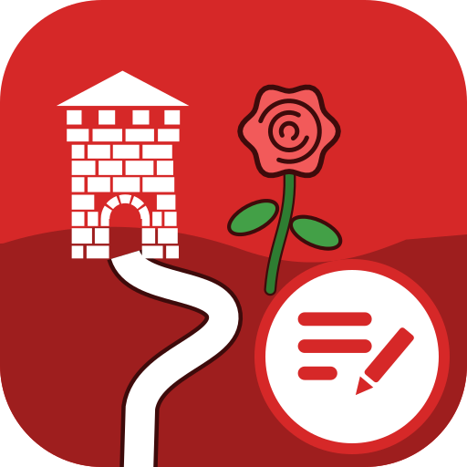

<h1 align="center">Rosenweg Notizen</h1>

Notizen für die Smartphones der Siedlung Rosenweg – jede Notiz ist eine Textdatei in der eigenen Rosenweg-Nextcloud.

<a href="https://www.rosenweg4303.ch/apps">Herunterladen</a> · <a href="docs/anleitung.md">Anleitung</a> · <a href="docs/entwickeln.md">Für Entwickler</a>

## Was die App kann

- Notizen und Checklisten schreiben.
- Alles liegt in `Persönlich/Notizen` – auch vom Computer oder einem anderen Telefon aus lesbar und bearbeitbar.
- Gleicht von selbst ab; bei gleichzeitigen Änderungen entsteht eine Konfliktkopie statt eines Verlusts.
- Gesperrte Notizen bleiben nur auf dem Telefon.
- Einstellungen gehören der Person und sind auf jedem Telefon wieder da.

## Plattformen

Android.

## Entwickeln

Android-App (Kotlin) auf Basis von Fossify Notes, gebaut gegen
[commons-rosenweg](https://github.com/Rosenweg/commons-rosenweg): `./gradlew assembleFossRelease` –
Bau, Signatur, Logo und Veröffentlichung stehen in [docs/entwickeln.md](docs/entwickeln.md).

## Herkunft und Lizenz

Basiert auf [Fossify Notes](https://github.com/FossifyOrg/Notes) – herzlichen Dank an das Fossify-Team und alle Mitwirkenden.
GPL-3.0, siehe [LICENSE](LICENSE).
